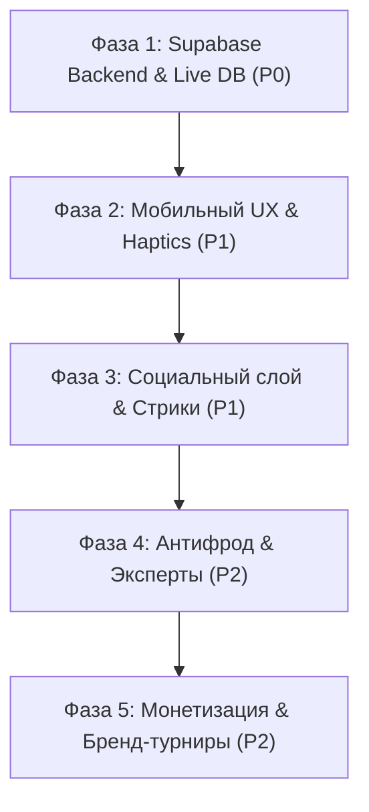

# 🧭 Opinion Net — Мастер-паспорт проекта и Стратегический Roadmap

> **Версия**: 2.5 | **Последнее обновление**: Октябрь 2026  
> **Статус проекта**: Активная фаза разработки (Pre-production / Mock-to-Supabase transition)  
> **Технологический стек**: Next.js 14 (App Router) · React 18 · TypeScript · Tailwind CSS · Redux Toolkit · Supabase (PostgreSQL, Auth, Storage, Edge Functions) · Firebase Hosting (CDN)  
> **Связанные документы**: [`docs/PROJECT_DOCUMENTATION.md`](file:///c:/Users/samze/Desktop/react-app/docs/PROJECT_DOCUMENTATION.md), [`docs/DATA_LAYER.md`](file:///c:/Users/samze/Desktop/react-app/docs/DATA_LAYER.md), [`docs/DESIGN_SYSTEM.md`](file:///c:/Users/samze/Desktop/react-app/docs/DESIGN_SYSTEM.md), [`LIVE_BATTLE_FEED_ARCHITECTURE.md`](file:///c:/Users/samze/Desktop/react-app/LIVE_BATTLE_FEED_ARCHITECTURE.md)

---

## 1. Миссия и концепция продукта (Product Vision)

### 1.1. Главная идея
**Opinion Net** — это мобильно-ориентированная платформа нового поколения для проведения честных визуальных конкурсов, тематических фото-батлов и турниров. 

В отличие от традиционных соцсетей, где побеждает тот, кто покупает накрутки или имеет миллионную базу ботов, Opinion Net превращает голосование в **захватывающий спорт с математически честным судейством**:
- **Для зрителей**: Лента дуэлей в формате TikTok/Reels — мгновенное вовлечение, красивые фотографии, возможность влиять на исход турнира и прокачивать собственный вес голоса (**Trust Score**).
- **Для авторов и участников**: Честный социальный лифт, признание таланта, обратная связь от живой аудитории, портфолио, ссылки на спонсоров и шанс выиграть ценные призы.
- **Для брендов и спонсоров**: Нативный контакт с вовлеченной аудиторией в тематических турнирах (фотография, стиль, дизайн, макияж, архитектура).

### 1.2. Фундаментальные принципы (Philosophy & Core Values)
| Принцип | Реализация в системе |
| :--- | :--- |
| **Абсолютная честность** | Многоуровневый **Trust Score**: вес голоса зависит от активности, возраста аккаунта и разнообразия выборов. Схлопывание IP-кластеров защищает от ботнетов. |
| **Приватность и анти-стадность** | Голосование анонимно. Никаких «сырых» счетчиков голосов. Проценты в батлах открываются **только после** того, как пользователь сделал свой выбор. |
| **Иммерсивный визуал** | Дизайн уровня Pinterest и VSCO: темная премиальная тема, полноэкранный 50/50 сплит, динамический Ambient Glow под тон кадра, отсутствие визуального мусора. |
| **Низкий порог входа** | Подача заявки занимает 1 минуту (фото, заголовок, краткое описание, ссылка на соцсети или спонсора). |
| **Глобальный охват** | Интерфейс, уведомления, карточки и правила ведутся строго на **английском языке** для международного масштабирования. |

---

## 2. Ключевые форматы соревнований

```
                                  ┌───────────────────────────┐
                                  │   ФОРМАТЫ OPINION NET     │
                                  └─────────────┬─────────────┘
             ┌───────────────────┬──────────────┴──────────────┬───────────────────┐
             ▼                   ▼                             ▼                   ▼
    ┌─────────────────┐ ┌─────────────────┐           ┌─────────────────┐ ┌─────────────────┐
    │ 1v1 Live Battle │ │ Stage Tournament│           │    Live Race    │ │ Eternal Hall    │
    │  (TikTok-лента) │ │  (Группы по 4)  │           │ (Онлайн-гонка)  │ │   (Зал славы)   │
    │  Мгновенный     │ │ Этапы, очки,    │           │ Вебсокеты,      │ │ Долгосрочный    │
    │  свайп-баттл    │ │ плей-офф, финал │           │ смена позиций   │ │ выбор топов     │
    └─────────────────┘ └─────────────────┘           └─────────────────┘ └─────────────────┘
```

1. **1v1 Live Battle (Дуэли)**:
   - Вертикальный 50/50 сплит-экран (Красный угол против Зеленого угла).
   - Быстрые вертикальные свайпы/колесико мыши/стрелки клавиатуры.
   - Голосование в один клик с мгновенной тактильной и визуальной отдачей (зум, рамка, проценты).
2. **Stage Tournament (Турнирный групповой чемпионат)**:
   - Четко выверенный турнирный движок: группы строго по **4 участника**.
   - Начисление очков по формуле $3 \times \frac{n - \text{rank}}{n - 1}$ (1 место = 3 очка, 2 место = 2 очка, 3 место = 1 очко, 4 место = 0).
   - Ежедневный цикл раундов, выход топ-2 из каждой группы в плей-офф и суперфинал.
3. **Live Race (Гонка в реальном времени)**:
   - Динамический лидерборд нескольких участников с изменением позиций на лету через Supabase Realtime.
4. **Eternal Hall of Fame (Зал славы)**:
   - Непрерывные рейтинги лучших работ за все время с возможностью для пользователя в любой момент изменить свой голос.

---

## 3. Текущее состояние проекта (Baseline / Что уже работает)

На данный момент в проекте заложен монолитный архитектурный фундамент:

- [x] **Архитектурный каркас**: Next.js 14 App Router, TypeScript, Redux Toolkit, Tailwind CSS.
- [x] **Универсальный Data Layer**: Сервисный фасад (`src/services/index.ts`), изолирующий UI от базы данных и позволяющий прозрачно переключаться между Mock DB и Supabase через переменную окружения `NEXT_PUBLIC_DATA_SOURCE`.
- [x] **TikTok Live Battle Feed (`TikTokBattleView`)**:
  - 4 канала управления: сенсорные тач-свайпы, колесико мыши с дебаунсом, drag-перетаскивание Framer Motion, стрелки клавиатуры.
  - Умный прелоадинг картинок следующих батлов в кэш браузера.
  - Оптимистичный UI: сжатие выбранного кадра на 12%, изумрудная неоновая подсветка, бейдж «Selected», показ процентов.
  - Полноразмерный модальный просмотрщик фото (`PhotoLightbox`) с зумом (1x, 1.5x, 2.5x), каруселью мульти-фото и динамическим Ambient Glow.
- [x] **Математический турнирный движок (`src/utils/groupAlgorithm.ts`)**:
  - Строгое разбиение на четверки, распределение остатков без ущербных групп из 1 человека.
  - Начисление очков и тай-брейки.
- [x] **Автоматизированное тестирование**:
  - Модульный тест полного цикла [`scripts/test-tournament-engine.mjs`](file:///c:/Users/samze/Desktop/react-app/scripts/test-tournament-engine.mjs) (50 проверок из 50 успешно проходят, `npm test`).
- [x] **Оптимизация быстродействия и Lazy Loading**:
  - Адаптивные миниатюры, поддержка Supabase Storage CDN, отсутствие зависаний при длинных лентах.
- [x] **PWA и инфраструктура**:
  - Подготовлен манифест, Service Worker, кэширование GET-запросов, сборка протестирована (`npm run build`), настроен хостинг на Firebase Hosting и репозиторий GitHub.

---

## 4. Стратегический Roadmap развития (Этапы и Приоритеты)



---

### 🚀 ФАЗА 1: Переход на живой бэкенд Supabase (Приоритет: P0 — Критический)
*Цель: Полный отказ от заглушек и мок-данных, работа с реальной СУБД PostgreSQL.*

- [ ] **Развертывание схемы в Supabase Cloud**:
  - Применение SQL-скрипта миграций `supabase/migrations/001_voting_platform.sql` (таблицы `contests`, `participants`, `contest_groups`, `votes`, `user_trust`, `user_daily_log`, `fraud_flags`).
  - Настройка Row Level Security (RLS) политик для защиты данных.
- [ ] **Авторизация Supabase Auth**:
  - Настройка Email OTP / Magic Link с продакшн-доменом Firebase Hosting (чтобы ссылки подтверждения вели на живой сайт, а не на localhost).
  - Сохранение сессии в `localStorage` и привязка к Redux `authSlice`.
- [ ] **Интеграция Supabase Storage**:
  - Публичный бакет `contest-media` с папками `avatars/`, `submissions/`, `contests/`.
  - Автоматическое сжатие изображений на стороне клиента перед отправкой.
- [ ] **Серверный крон пересчета раундов (pg_cron / Edge Functions)**:
  - Функция `run_daily_cycle()`: запуск каждый день в 06:00 UTC для подведения итогов дня, начисления очков и формирования групп следующего этапа.
  - Функция `daily-trust-update`: ночной пересчет Trust Score активных пользователей.

---

### 📱 ФАЗА 2: Мобильный UX, анимации и тактильный отклик (Приоритет: P1)
*Цель: Ощущение нативного мобильного приложения высшего класса.*

- [ ] **Двойной тап для голосования (Double-Tap to Vote)**:
  - Быстрый дабл-тап по любой половине дуэли отдает голос с красивой всплывающей анимацией (неоновая молния, искра или сердце) в точке касания.
- [ ] **Тактильная вибро-отдача (Web Vibration API)**:
  - Легкий щелчок (`15ms`) при пролистывании дуэли;
  - Плотный импульс (`[30ms, 40ms, 30ms]`) при фиксации голоса.
- [ ] **Pinch-to-Zoom прямо в карточке батла**:
  - Возможность двумя пальцами приблизить деталь фотографии прямо в ленте без перехода в отдельное модальное окно.
- [ ] **Интерактивный слайдер «До / После» (Split Slider)**:
  - Специализированный режим для конкурсов ретуши, дизайна, архитектуры и визажа с ползунком разделения фото.
- [ ] **Шеринг карточки батла в Instagram Stories и Telegram**:
  - Кнопка «Поделиться», которая за 1 секунду генерирует стильную сторис-картинку 9:16 с двумя соперниками, бейджем «VS» и QR-кодом для голосования.

---

### 👥 ФАЗА 3: Социальный слой, геймификация и удержание (Приоритет: P1)
*Цель: Возвращаемость пользователей и рост сообщества.*

- [ ] **Серии ежедневного голосования (Daily Streaks)**:
  - Виджет огонька в профиле: голосование 3, 7, 30 дней подряд дает буст к росту Trust Score (+5%, +10%, +20%).
- [ ] **Вкладка «Обсуждения и Рецензии» в карточке участника**:
  - Лаконичные комментарии к работам.
  - Мнения пользователей с высоким Trust Score (уровни *Trusted* и *Senior*) подсвечиваются особыми золотыми/неоновыми бейджами.
- [ ] **Режим персонального вызова (Challenger Mode)**:
  - Автор может кинуть персональный вызов другому автору на баттл 1v1 в заданной теме (Street, Cyberpunk, Minimal).
- [ ] **Расширенный профиль автора**:
  - Витрина наград: золотые кубки победителя, места в финалах, история лучших работ, блок ссылок на личный сайт и бренд спонсора.

---

### 🛡️ ФАЗА 4: Продвинутый антифрод и система кармы (Приоритет: P2)
*Цель: Защита от изощренных способов накрутки при росте аудитории.*

- [ ] **IP-Collapse через Edge Functions**:
  - Хэширование IP-адресов с секретной солью `SHA256(ip + SALT)`.
  - Ограничение: если с одного IP поступает более 10 голосов за одного кандидата, вес всех последующих голосов падает до `0.1`.
- [ ] **Детектор аномалий (Fraud Flags)**:
  - Флаги в панели администратора: `ip_cluster` (30+ голосов с <5 IP), `speed_voting` (5+ голосов за минуту), `new_account_burst` (массовые голоса от свежесозданных аккаунтов).
- [ ] **Институт верифицированных экспертов (Critic Role)**:
  - Профессиональные жюри получают подтвержденную галочку и отдельный весовой коэффициент голоса.

---

### 💎 ФАЗА 5: Монетизация и бренд-платформа (Приоритет: P2)
*Цель: Превращение проекта в самоокупаемый и прибыльный бизнес.*

- [ ] **Спонсорские битвы под ключ (Branded Contests)**:
  - Бренды (Canon, Sony, Nike, косметические бренды) получают брендированный экран турнира, размещение логотипов и прямые ссылки на свои товары.
- [ ] **Донаты и гранты авторам (Creator Tips)**:
  - Зрители могут выразить респект автору донатом прямо со страницы работы.
- [ ] **Витрина пресетов и оборудования**:
  - В описании конкурсного кадра автор может прикрепить ссылку на покупку своего Lightroom-пресета или указать модель камеры/объектива.
- [ ] **PWA Web Push уведомления**:
  - Напоминания: «Твой фаворит прошел в полуфинал!», «Начался финальный раунд».

---

## 5. Архитектурные табу (Чего платформа принципиально НЕ делает)

Чтобы продукт сохранял фокус, высокую скорость и премиальное качество, действуют строгие ограничения:

1. ❌ **Никакого спама конкурсов от пользователей**: Создавать турниры имеют право **только администраторы и проверенные бренды**. Пользователи могут только подавать заявки на участие и голосовать.
2. ❌ **Никаких сырых чисел голосов**: На сайте категорически запрещено показывать сырые значения (например, «1423 голоса против 451»). Показываются **только проценты**, чтобы исключить психологическое давление стадного чувства.
3. ❌ **Числовой Trust Score скрыт от пользователей**: Пользователь видит только свой визуальный уровень (*New*, *Regular*, *Trusted*, *Senior*) и мотивирующую подсказку, но точная цифра скрыта в целях безопасности против подбора алгоритмов накрутки.
4. ❌ **Никакой публичной истории чужих голосов**: Кто именно за кого проголосовал — строжайшая тайна. Пользователь видит только свои собственные прошлые голоса в закрытом профиле.
5. ❌ **Никаких двуязычных смесей в коде и интерфейсе**: Весь интерфейс для пользователей строго англоязычный (English), что обеспечивает готовность к глобальному запуску.

---

## 6. Инструкция для разработчиков и AI-ассистентов (How to Work on This Repo)

Если перед вами стоит задача доработать проект, следуйте этому протоколу:

1. **Проверьте сервисный контракт**: Все обращения к данным должны идти через `src/services/index.ts`. Запрещено писать прямые вызовы Supabase внутрь компонентов React.
2. **Используйте дизайн-токены**: Цвета задаются семантическими классами (`bg-surface`, `text-muted`, `bg-accent-solid`). Никаких случайных шестнадцатеричных цветов `#ff8833` в верстке.
3. **Запускайте тесты перед коммитом**:
   ```bash
   npm test        # Проверка всех 50 тестов турнирного движка
   npm run build   # Проверка успешной компиляции всех 11 страниц Next.js
   ```
4. **Соблюдайте мобильный приоритет**: Все новые экраны сначала проектируются под ширину 375–430px (iPhone/Android), и только затем масштабируются на десктоп.

---

*Этот документ является главным ориентиром для команды разработки и обновляется по мере завершения этапов.*
